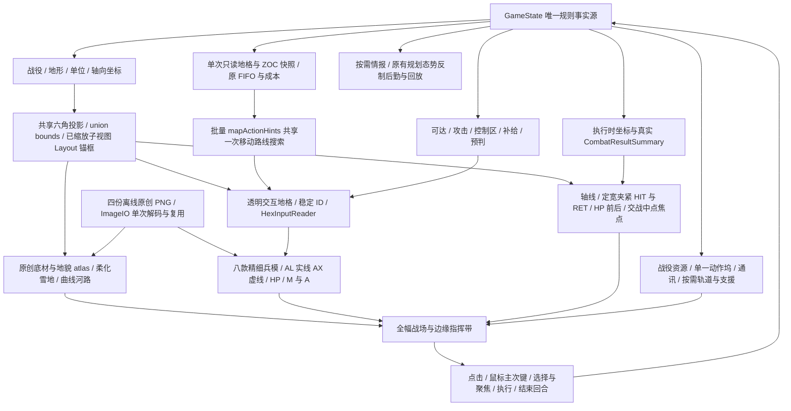
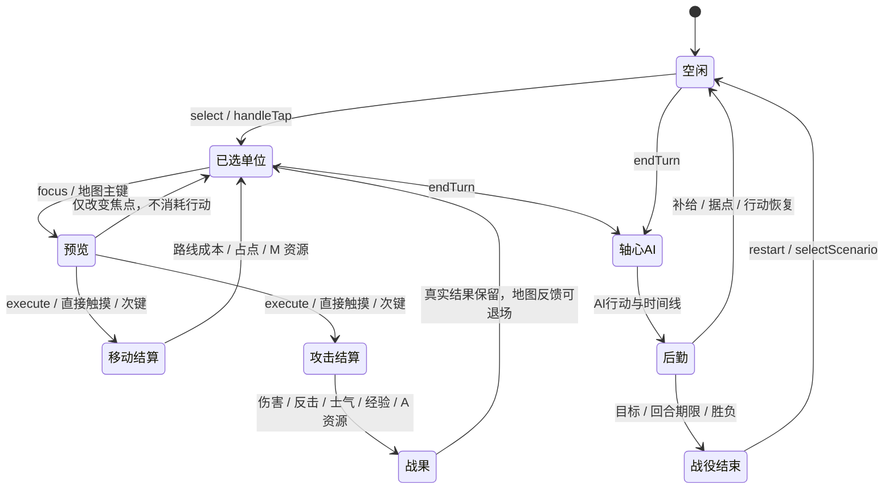
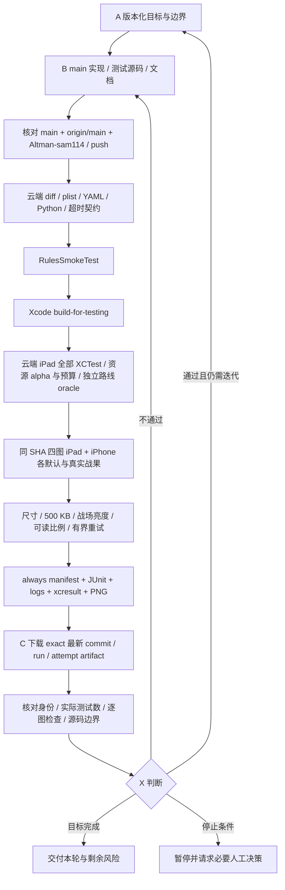

# WW2Tactics 当前流程图（v3.0）

## 战争沙盘渲染与操作

所有装饰不命中，所有规则只在 GameState。地图布局、单位、战果和输入共用坐标；绘制层不重算伤害。Inspector/支援/轨道开关与缩放是 SwiftUI 局部状态，不复制规则。

## 命令与回合

## 云端证据链

JUnit 的阶段数不冒充 XCTest 数。四图不证明触屏、VoiceOver 或全部设备实测。失败也产包；不回滚远端，只追加修复。当前无子智能体，按阶段顺序在当前会话实施。
