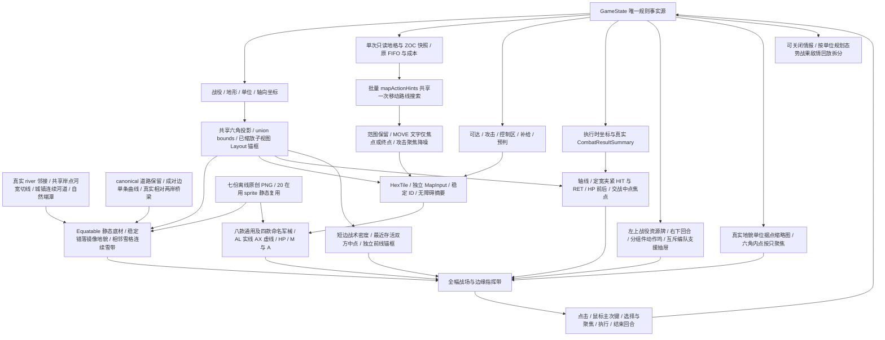
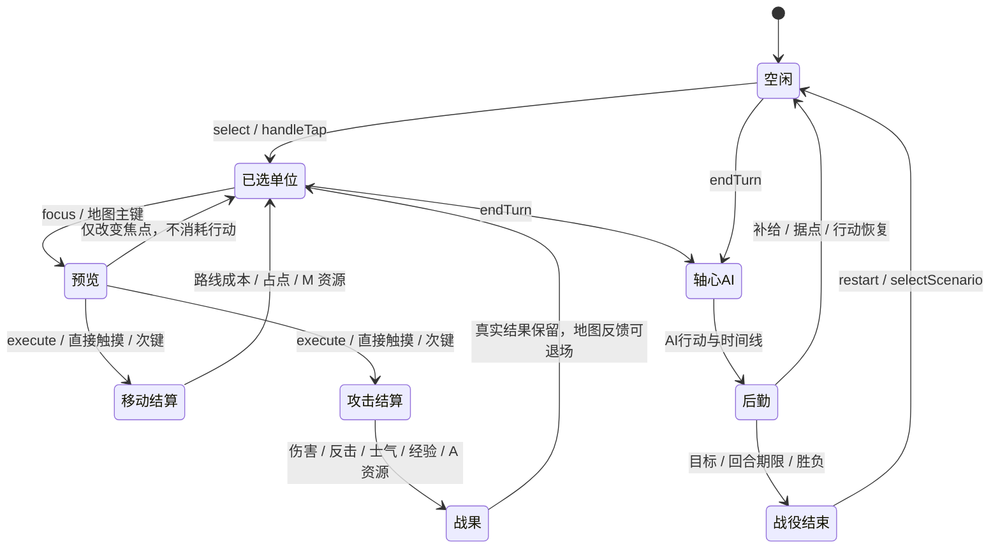
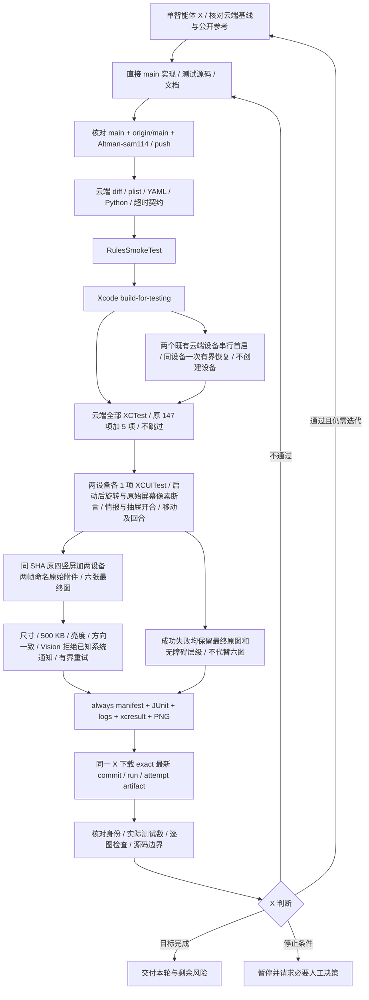

# WW2Tactics 当前流程图（v3.3）

## 战争沙盘渲染与操作

所有装饰不命中，所有规则只在 GameState。地图布局、单位、战果和输入共用坐标；绘制层不重算伤害。Inspector/支援/轨道/总览开关与缩放是 SwiftUI 局部状态，不复制规则。前线入口仅滚动；小地图白框表示真实规则焦点，不是视口框，空白和格外点击无操作。

## 命令与回合

## 云端证据链

JUnit 分开六阶段、目标 152 unit 与两设备各 1 UI。UI 设计覆盖明确的旋转/控件/抽屉/动作坞移动与回合路径，不证明逐格直接触屏、鼠标拖动、VoiceOver 或全字号，实际结果仍以最新包为准。桥梁/命名军械/地貌不改变规则；横屏由 XCUITest 旋转设备，原附件不转像素/修通知。失败也产包，逐设备保留错误，不回滚远端，只追加修复；本轮无 A/B/C 调度、无子智能体，所有验证云端。
